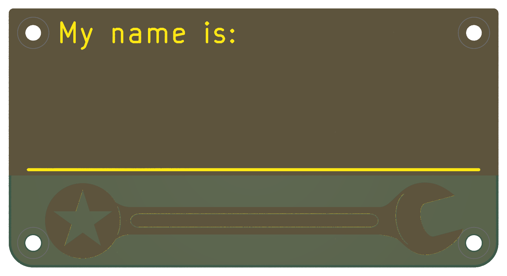

# MAKE Roanoke Name tag

A battery-powered, LED-lit "My name is" name tag for
MAKE Roanoke.

It is made of two stacked PCBs:

- **Back board:** holds all the electronics, including the battery, power
  switch, boost converter and 27 LEDs. This board provides 
  illumination to highlight the features on the front board.
- **Front board:** a plain faceplate with no parts. It has the "My name is:"
  silkscreen and a wrench graphic, and it covers the LED area of the back 
  board. The board lacks soldermask so that the wrench and the area with the 
  individual's name light up when the name tag is on.

The boards line up on four M3 mounting holes. They sandwich a 3D-printed
spacer between them and are held together with M3 nylon screws and nuts. The
spacer holds the boards apart so the LED light looks diffused through the
front board, and its walls stop the bright LED light from escaping out the
sides. A slot at the top of the back board is for a clip.

This project has been designed specifically to be built via reflow as part of a 
class.

Viewable links are here:
- [Schematic](https://github.com/sokrasins/nametag/blob/main/docs/nametag_back_schematic_rev4.pdf)
- [Back PCB](https://pcbview.io/?github=https%3A%2F%2Fgithub.com%2Fsokrasins%2Fnametag%2Fblob%2FHEAD%2Fpcbs%2Fnametag_back%2Fnametag_back.kicad_pcb)
- [Front PCB](https://pcbview.io/?github=https%3A%2F%2Fgithub.com%2Fsokrasins%2Fnametag%2Fblob%2FHEAD%2Fpcbs%2Fnametag_front%2Fnametag_front.kicad_pcb)
- [Assembly](https://htmlpreview.github.io/?https://raw.githubusercontent.com/sokrasins/nametag/refs/heads/main/docs/assembly/assembly_ibom.html)

## How it works

- **Power:** a single AA cell (Keystone 2460 holder) switched by an SPDT
  slide switch.
- **Boost converter:** a TI TPS613221A steps the cell up to a +3.3V rail.
- **LEDs:** 27× 1206 SMD LEDs (22 white, 5 green). Each one has its own
  current-limiting resistor to GND: 270 Ω for the white LEDs, 330 Ω for the
  green.
- **Brightness:** fixed. This revision (Rev 4) has no brightness control; the
  LEDs run at about 2.3–2.6 mA each whenever the switch is on. The board draws
  about 160–300 mA from the cell, which works out to roughly 8–10 hours on an
  alkaline AA or an eneloop.

See [docs/power_analysis.md](docs/power_analysis.md) for current draw and
battery life estimates.

## Boards

| | Back | Front |
| --- | --- | --- |
| Size | 100 × 78 mm | 100 × 53 mm |
| Layers / thickness | 2 / 1.6 mm | 2 / 0.8 mm |
| Components | All electronics | None (4× M3 holes) |

## Other parts needed

Besides the two PCBs and the parts in [docs/bom.csv](docs/bom.csv), each
name tag needs:

| Qty | Part | Notes |
| --- | --- | --- |
| 4 | M3 × 20 mm nylon screw | |
| 4 | M3 nylon nut | |
| 1 | 3D-printed spacer | [mech/nametag_spacer_v1.3mf](mech/nametag_spacer_v1.3mf) |
| 1 | Plastic name tag clip | Attaches through the slot at the top of the back board |

This exploded view shows how the boards, spacer, screws and nuts fit together:

## Printing the spacer

The spacer prints fine with your favorite standard settings. The
original was printed in black PLA, which helps block light from leaking out
the sides, but almost any filament should work.

## Adding your name

The front board leaves an open area for your name, and the LEDs behind it
light it up. How you fill it in is up to you. Some options:

- **Marker:** a Sharpie works, but it doesn't give much contrast against the
  lit board.
- **Letter stickers:** spell out your name with adhesive letters.
- **Cut vinyl:** cut your name or a design out of vinyl with a vinyl cutter.
- **Laser-cut design:** cut a design to sit over the name area.
- **Custom front PCB:** copy `pcbs/nametag_front/` and add your name as text,
  then order it in place of the default front board.

There are lots of creative possibilities, so have fun with it.

## Repository layout

| Path | Contents |
| --- | --- |
| `pcbs/nametag_back/` | Back board KiCad project (schematic and layout) |
| `pcbs/nametag_back/gerbs/` | Back board Gerbers and drill files |
| `pcbs/nametag_front/` | Front board KiCad project (layout only, no schematic) |
| `pcbs/nametag_front/gerbs/` | Front board Gerbers and drill files |
| `docs/assembly/assembly_ibom.html` | Interactive BOM for assembling the back board |
| `docs/assembly/assembly_guide.pdf` | Printable assembly guide, one step per component, two steps per page |
| `docs/assembly/assembly_guide_grayscale.pdf` | The same guide for black-and-white printers |
| `docs/bom.csv` | Bill of materials for the back board, with LCSC / Digi-Key part numbers |
| `mech/nametag_spacer_v1.3mf` | 3D-printable spacer |
| `scripts/` | Scripts that generate the renders, schematic PDF and assembly docs ([usage](scripts/README.md)) |

## Notes

- **No useful battery cutoff:** once running, the boost converter (TPS613221A)
  keeps drawing power until the cell falls to about 0.4 V, where its
  undervoltage lockout finally trips. That is far below a safe end-of-discharge
  voltage (~0.9–1.0 V), so the badge will happily over-discharge the battery.
  Don't leave it on until it dies: switch it off when it starts to blink or
  drop out, and replace an alkaline cell or recharge an eneloop promptly. Deep
  discharge shortens NiMH cell life and makes alkaline cells more likely to
  leak. See [docs/power_analysis.md](docs/power_analysis.md).
