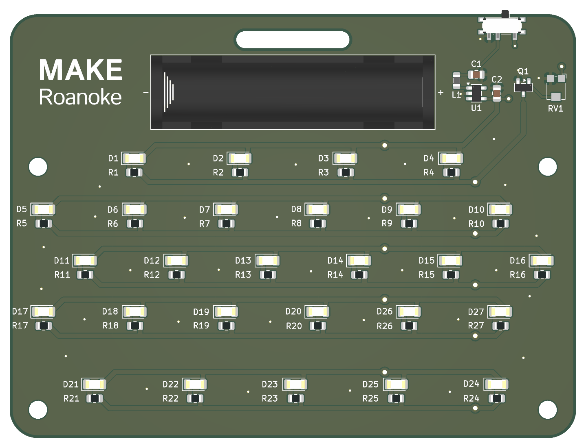
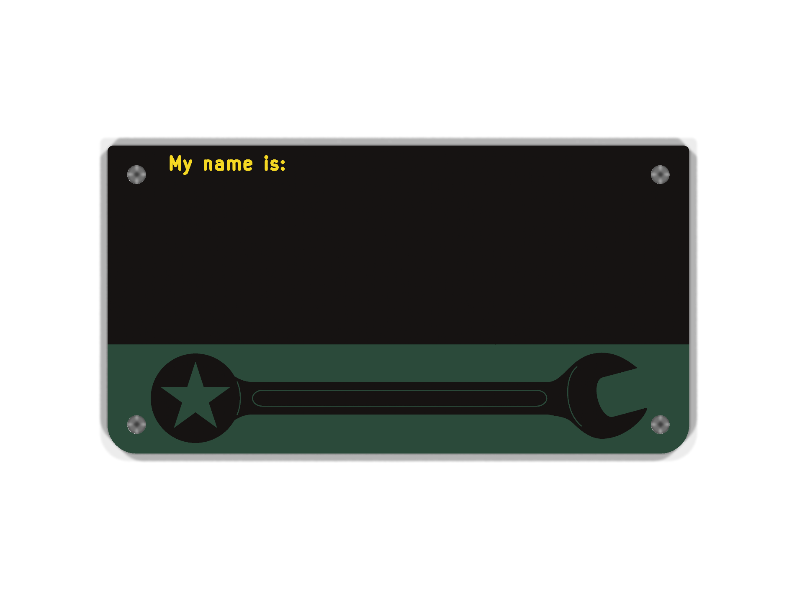

# MAKE Roanoke Name tag

A battery-powered, LED-lit "My name is" name tag for
MAKE Roanoke, designed in KiCad 9.

It is made of two stacked PCBs:

- **Back board:** holds all the electronics, including the battery, power
  switch, boost converter, brightness pot and 27 LEDs. This board provides 
  illumination to highlight the features on the front board.
- **Front board:** a plain faceplate with no parts. It has the "My name is:"
  silkscreen and a wrench graphic, and it covers the LED area of the back 
  board. The board lacks soldermask so that the wrench and the area with the 
  individual's name light up when the name tag is on.

The boards line up on four M3 mounting holes and are held together with
standoffs. A slot at the top of the back board is for a clip.

This project has been designed explicitly to be built via reflow as part of a 
class.





## How it works

- **Power:** a single AAA cell switched by an SPDT slide switch.
- **Boost converter:** a TI TPS613221A steps the cell up to a +3V3 rail.
- **LEDs:** 27× SMD LEDs (22 yellow, 5 green). Each one has a 1 kΩ
  current-limiting resistor.
- **Brightness:** all LEDs share a single BSS138 low-side MOSFET. A 10 kΩ
  Bourns TC33X trimmer potentiometer divides the 3.3 V rail and drives its
  `CTRL` gate line, so turning it dims or brightens every LED together.

## Boards

| | Back | Front |
| --- | --- | --- |
| Size | 100 × 75 mm | 100 × 53 mm |
| Layers / thickness | 2 / 1.6 mm | 2 / 1.6 mm |
| Components | All electronics | None (4× M3 holes) |

## Repository layout

| Path | Contents |
| --- | --- |
| `nametag_back/nametag_back.kicad_pro` | Back board KiCad project |
| `nametag_back/nametag_back.kicad_sch` | Top-level schematic: battery, switch, boost converter, brightness pot, mounting holes |
| `nametag_back/leds.kicad_sch` | Hierarchical `LEDs` sheet: 27 LED / resistor pairs and the shared low-side MOSFET |
| `nametag_back/nametag_back.kicad_pcb` | Back board layout |
| `nametag_back/gerbs/` | Back board Gerbers and drill files |
| `nametag_front/nametag_front.kicad_pro` | Front board KiCad project (PCB only, no schematic) |
| `nametag_front/gerbs/` | Front board Gerbers and drill files |
| `bom/ibom.html` | Interactive BOM for assembling the back board |
| `docs/` | 3D renders of both boards and a PDF of the back board schematic |
| `docs/power_analysis.md` | Current draw, battery life and thermal estimates for the back board |
| `scripts/render_pcbs.sh` | Regenerates the renders and schematic PDF in `docs/` |

## Regenerating the renders and schematic PDF

With KiCad 9 or newer installed, run:

```sh
scripts/render_pcbs.sh          # top side (the images above)
scripts/render_pcbs.sh both     # also writes *_render_bottom.png
```

It calls `kicad-cli pcb render` for each board and `kicad-cli sch export pdf`
to write `docs/nametag_back_schematic_rev<N>.pdf`, where `<N>` is the
revision from the schematic's title block. Set `KICAD_CLI` if
`kicad-cli` isn't on your `PATH`. `QUALITY`, `WIDTH`, `HEIGHT` and `BACKGROUND`
change the output.

## Open items

- The top-level schematic still has a couple of "TODO: Verify" notes.
